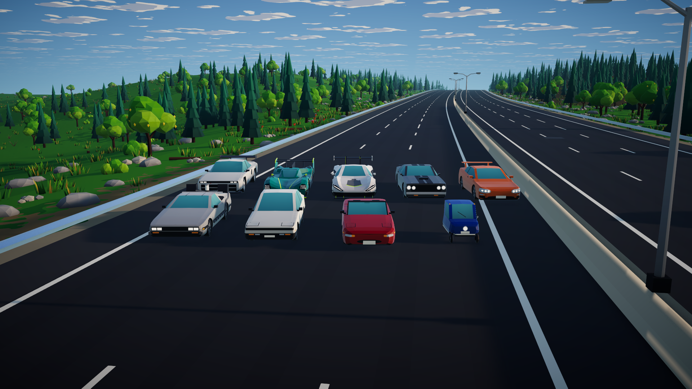
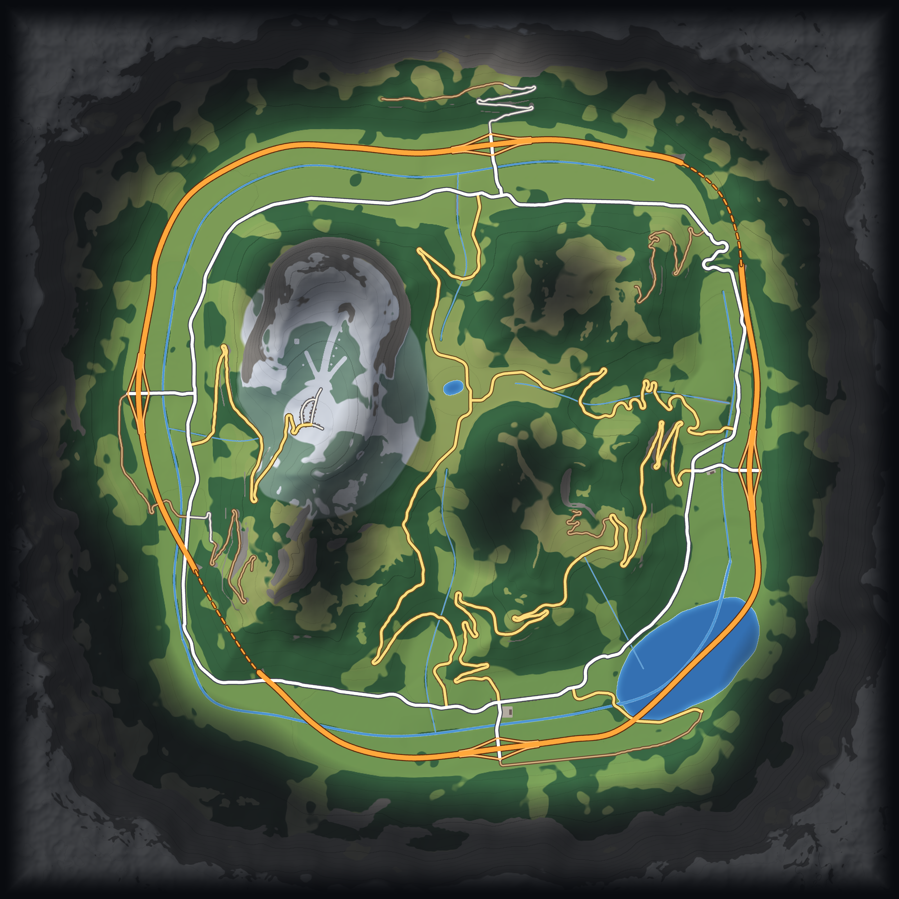

# Chill Road

**A low-poly driving game in an alpine valley: motorway loops, hairpin passes, country roads and dirt tracks, at your own pace, alone or with friends.**



Chill Road is made with Unity 6 (URP). It started as an endless-traffic, near-miss score game and is now a free-roam drive across a 5 km alpine map. It is **in development**: expect rough edges and things that change.

Every line of code, every 3D model, shader, sound and texture was made with AI (Claude, through Claude Code), following a human's direction, references, feedback and playtesting. The project uses no asset packs and no third-party models.

> 🇫🇷 Une version courte en français se trouve [en bas de la page](#en-français).

## The game



- **"Tour du massif"**: a ring valley around a central massif, with about 55 km of roads:
  - a 14.7 km 2×3-lane motorway loop, with four interchanges, a viaduct over the lake and two tunnels;
  - a country road around the inner valley;
  - three hairpin roads up to a central pass at 441 m;
  - dirt tracks to the lake and the high pastures.

  The village sites are reserved but have no buildings yet.
- **Ambient traffic**: about 25 vehicle types, from city cars and taxis to buses, semis, cement mixers, fire engines, motorbikes and farm tractors. Traffic uses the motorway exits.
- **A garage of hand-built cars**, from a three-wheeled 49 cc microcar to a V12 Le Mans hypercar. Hold *reset* to switch cars without stopping.
- **Physics with some weight**: raycast suspension, a tire model, gearboxes from 3 to 9 speeds and a handbrake. Drifts come from real sliding, and stability control only catches real spins.
- **Day/night cycle and storms**: rain, lightning, a road that slowly gets wet (reflections, less grip). The chance of rain is a setting.
- **Synthesized audio**: every engine voice is generated live (V8, flat-plane turbo V8, V12, V6, turbo six, four-cylinder, 49 cc two-stroke, electric), and so is the synthwave soundtrack. The game ships no audio files. To play your own music, drop `.ogg`, `.mp3` or `.wav` files into `StreamingAssets/Music` in the build.
- **Network multiplayer (experimental)**: host or join from *Multiplayer* on the title screen.
  - **Host**: you play and the others join you. Once the game is open, an **invite code** appears on screen; it stays in the menu, with a button that copies it. Give it to your friends.
  - **Join**: type the host's invite code. It works over the Internet with nothing to set up on the router. Games on the local network also show up by themselves, and you can still join by IP address (UDP port 47777, which the host forwards on their router to play over the Internet without a code).
  - The host decides, before opening the game, whether the players' cars collide or pass through each other. The time of day, the weather and the traffic are the host's, the same for everyone.
  - **Races together**: start a race and every player gets an invitation (accept with E, Enter or A; decline with N or D-pad down). Those who accept line up on the grid for a shared countdown, with a live ranking and a results board. The starter picks the traffic for the race and can lend their car to everyone.
  - The horn and headlight flashes are heard and seen by the other players. On the world map, pick a friend to get a GPS route that follows them.
  - It runs on custom UDP netcode. Invite codes go through Unity Relay, with an anonymous sign-in: no name or e-mail is sent.
- **Minimap, world map and GPS route guide.**
- Touch controls for a future mobile build, and an English/French interface.

## Controls

| Action | Keyboard | Gamepad |
|---|---|---|
| Throttle | W / Z / ↑ | RT |
| Brake · reverse | S / ↓ | LT |
| Steer | A / Q · D, ← → | Left stick |
| Handbrake | Space | B / RB |
| Headlights | L | L3 |
| Flash headlights | F | D-pad down |
| Look around | Right-click + mouse | Right stick |
| Change camera | C / V | X |
| Horn | H | R3 |
| Look back | B | LB |
| Reset · in a race, hold: abandon | R | Y |
| Next song | M | D-pad up |
| Map | , | Select |
| Pause | Esc / P | Start |

QWERTY and AZERTY layouts both work. A gamepad is recommended.

## Running the project

1. Install **Unity 6000.3.11f1** (see [ProjectVersion.txt](ProjectSettings/ProjectVersion.txt)).
2. Clone the repository and open the folder from Unity Hub. The first import rebuilds the `Library` folder and takes a while.
3. Open the scene [Assets/ChillRoad/ChillRoad.unity](Assets/ChillRoad/ChillRoad.unity) and press Play. Loading the map takes about a minute in the editor.

Everything else lives under the **Chill Road** editor menu:

| Menu | What it does |
|---|---|
| `Setup (assets + scène)` | Rebuilds the game assets and the scene |
| `Importer pack voitures` · `Importer voitures jouables` · `Importer Vision 74` | Imports the traffic and playable cars exported from Blender |
| `Importer pack environnement` · `Importer le pack alpin` | Imports nature, props and alpine models |
| `Matériaux de route` · `Matériaux du monde` | Recreates the road and world materials |
| `Build Windows` · `Build Windows + zip` | Builds `Builds/Windows/Chill Road.exe`, optionally zipped |

### Dedicated server

A Windows build can run as a dedicated server, with no local car and a spectator camera:

```
"Chill Road.exe" -server [-port 47777] [-name "My server"] [-players N] [-nocollisions] [-invite]
```

- `-port`: UDP port (47777 by default; forward it on the router so players can join by IP over the Internet).
- `-name`, `-players`: the server's name in the list of games, and the number of seats (8 by default, 16 at most).
- `-nocollisions`: the players' cars pass through each other. The choice is made when the server starts and stays the same for the whole game.
- `-invite`: asks for an invite code, shown in the server window and written to its log. Players can then join with the code, with no port to forward. Without this option the server contacts no online service.

The build also writes a `Serveur dedie.bat` next to the executable.

### Starting a network game from the command line

The game itself can skip the title screen, for a desktop shortcut or for tests with several copies of the game:

```
"Chill Road.exe" -host [-nocollisions]
"Chill Road.exe" -join CODE
"Chill Road.exe" -join 192.168.1.20[:47777]
```

`-host` opens a game and asks for its invite code; `-join` takes an invite code or an address. If joining fails, the game stays on the title screen and the reason is written to the log.

Adding `-nettest [seconds]` turns that copy into an unattended test player: every two seconds it logs what it sees of the game (link, latency and data rate through the relay, the other players' cars, the race), it accepts race invitations, drives straight for a few seconds after the start, then abandons. With a number of seconds, it quits by itself.

## Repository layout

```
Assets/ChillRoad/
  Scripts/      C# game code: Core, Vehicle, Traffic, World, Net, UI, Gameplay, Editor, DebugTools
  Shaders/      flat-style road, terrain, sky, water and foliage shaders
  Models/       FBX exported from Blender: CarPack (traffic), PlayerCars, Vision74, EnvPack, AlpPack
  Resources/Map baked map data (heights, masks, road network, minimap and overview images)
Tools/
  Blender/      Python scripts that build every model in Blender, plus the .blend sources
  Map/          Python map baker (terrain, roads, earthworks, signage) → Resources/Map
  Net/          netbot.py, a fake client/server to test the netcode against the editor (direct UDP only, no invite codes)
  ItchCapture/  scripted screenshot director used for the itch.io page
  RoadTextures/ road texture generator
Marketing/itch/ itch.io page text (EN/FR), covers and screenshots
```

### Content pipelines

- **3D models**: run the scripts in `Tools/Blender` in Blender 5.x to build models from code (for example `pack_lib.py` + `pack_cars.py` for traffic, `play_cars.py` for playable cars, `alp_*.py` for the alpine pack). They export FBX into `Assets/ChillRoad/Models`, and the import menus above set up the materials and prefabs.
- **Map**: `python Tools/Map/map_bake.py` (Python 3 with `numpy` and `Pillow`) generates the relief, roads, earthworks, masks and previews, then exports to `Assets/ChillRoad/Resources/Map`. `--roads` does the layout and previews only. The map itself is defined in `map_def.py`.

## En français

**Chill Road** est un jeu de conduite low-poly sous Unity 6 (URP), **en cours de développement**. Tu roules librement dans une vallée alpine de 5 km, appelée « Tour du massif ». Elle a une autoroute en boucle avec échangeurs, viaduc et tunnels, une route de vallée, trois routes de col en lacets et des chemins de terre. On y trouve du trafic, un cycle jour/nuit et des orages. L'interface est en français et en anglais.

On peut y rouler à plusieurs en réseau (expérimental). Un joueur héberge la partie et reçoit un code d'invitation ; ses amis le tapent pour le rejoindre par Internet, sans rien régler sur leur box. Le réseau local (parties trouvées toutes seules) et l'adresse IP marchent aussi. L'hôte choisit si les voitures des joueurs se percutent ou se traversent. On peut lancer des courses à plusieurs, klaxonner et faire des appels de phares, et demander au GPS de mener à un ami. Un serveur dédié est possible (`-server`, avec `-invite` pour obtenir un code).

Tout le projet a été réalisé avec l'IA (Claude via Claude Code), sur les directions d'un humain : le code, les modèles 3D construits par scripts Blender, les shaders, et les sons et la musique synthétisés en direct. Le projet n'utilise aucun asset tiers.

Pour l'ouvrir, installe Unity **6000.3.11f1**, ouvre le dossier depuis Unity Hub, puis lance la scène `Assets/ChillRoad/ChillRoad.unity`. Les outils se trouvent dans le menu **Chill Road** de l'éditeur.
